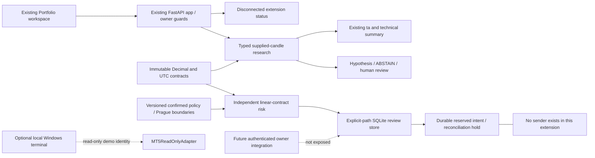

# Architecture

Existing `src/trading/pipeline.py`, `src/execution/order_manager.py` and `src/desk/`
remain separate legacy paths. Their existing kill/mode/pretrade/reduce-only gates
are retained; no new proposal is routed into them automatically.

Contracts use Pydantic 2, matching FastAPI's installed schema stack. Provider
identity is explicit; FX lots are never passed into legacy share-sized orders.
Data observations carry provider, symbol, UTC timestamps, quality and permissions.
Technical indicator work uses the existing pandas/ta stack; exact money/risk is
Decimal. There is no model import below the deterministic trading boundary.

`ReviewStore` is additive schema version 1: proposals, approvals, intents, audit
and rule_boundaries. Foreign keys, BEGIN IMMEDIATE and synchronous FULL support
single-use approval and atomic intent persistence across connections. No default
store is created by imports, HTTP handlers or startup. No production migration.
